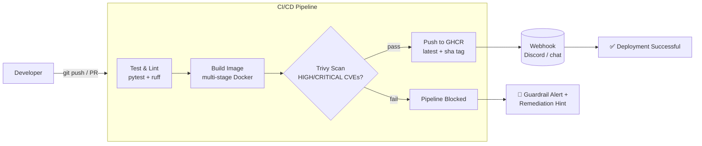

# Automated CI/CD Pipeline for a Containerized Chatbot with Real-Time Deployment Notifications

A containerized **DevOps Chatbot API** (FastAPI) with a fully automated CI/CD pipeline on GitHub Actions: unit tests → lint → Docker build → Trivy CRITICAL-CVE guardrail → image published to GitHub Container Registry (GHCR) → real-time deployment notifications via webhook.

## Architecture



Every commit to `main` and every pull request flows through the pipeline. If automated tests fail or Trivy finds a fixable **HIGH or CRITICAL** vulnerability in the image, the pipeline is blocked *before* the image reaches the registry, and a failure notification with a remediation hint is sent to the team channel.

## Tech Stack

| Layer | Tool |
|---|---|
| API | FastAPI 0.143.0 + Uvicorn 0.54.0 (Python 3.12) |
| Testing | pytest 9.1.1, httpx 0.28.1 |
| Linting | ruff 0.17.0 |
| Containerization | Docker (multi-stage build, non-root user, minimal `python:3.12-slim` image) |
| CI/CD | GitHub Actions (`checkout@v4`, `setup-python@v5`, `setup-buildx-action@v3`, `build-push-action@v6`, `login-action@v3`) |
| Security scanning | Trivy (`aquasecurity/trivy-action@0.36.0`) — HIGH + CRITICAL guardrail |
| Artifact registry | GitHub Container Registry (GHCR) |
| Notifications | Generic webhook (Discord-compatible JSON payload) |

## Repository Structure

```
chatbot-cicd-pipeline/
├── .github/workflows/pipeline.yml   # CI/CD pipeline definition
├── Dockerfile                        # multi-stage, non-root container build
├── requirements.txt                  # runtime dependencies
├── requirements-dev.txt              # test + lint dependencies
├── pyproject.toml                    # pytest + ruff configuration
├── app/
│   ├── __init__.py
│   ├── main.py                       # FastAPI application
│   └── test_main.py                  # pytest suite (8 tests)
└── docs/screenshots/                 # pipeline evidence (see below)
```

## API

| Endpoint | Method | Description |
|---|---|---|
| `/` | GET | Health check → `{"status": "healthy", "service": "chatbot"}` |
| `/chat` | POST | Body `{"message": "<text>"}`. Known commands: `ping` → `pong`, `status` → operational status, `cost` → budget run rate. Unknown messages get a helpful fallback reply. Invalid payloads return `422`. |

```bash
curl -s localhost:8000/
curl -s -X POST localhost:8000/chat -H 'Content-Type: application/json' -d '{"message": "ping"}'
```

## Run Locally

```bash
# Create and activate a virtual environment
python3 -m venv .venv
.venv/bin/pip install -r requirements.txt -r requirements-dev.txt

# Run the API
.venv/bin/uvicorn app.main:app --reload

# Run tests and lint
.venv/bin/python -m pytest -v
.venv/bin/ruff check app/

# Run in Docker
docker build -t chatbot-api .
docker run -p 8000:8000 chatbot-api
```

## CI/CD Pipeline

Triggered on **push to `main`** and **pull requests targeting `main`**:

1. **Run Unit Tests & Lint** — installs dependencies, runs `ruff check app/`, then `pytest` (8 tests covering every endpoint, fallback behavior, and 422 validation).
2. **Build, Scan & Publish** — builds the image with Buildx, scans it with Trivy. Any fixable HIGH or CRITICAL CVE fails the pipeline (`exit-code: 1`). On `main` pushes only, the image is pushed to GHCR as `ghcr.io/tatva06/chatbot-cicd-pipeline` with `latest` and commit-sha tags.
3. **Deploy & Notify** — on `main` pushes, posts a success or failure message (with remediation advice) to the configured webhook.

### Required Secrets

| Secret | Purpose |
|---|---|
| `NOTIFICATION_WEBHOOK` | Discord (or any webhook) URL for pipeline notifications |
| `GITHUB_TOKEN` | Provided automatically; granted `packages: write` permission for GHCR publishing |

## Pipeline Evidence

| Screenshot | What it shows |
|---|---|
| `docs/screenshots/actions-run.png` | Green GitHub Actions run (tests → build/scan/publish → notify) |
| `docs/screenshots/ghcr-package.png` | Published image in the GitHub Packages registry |
| `docs/screenshots/webhook-message.png` | Deployment success notification in Discord |

<!-- Paste the screenshots above into docs/screenshots/ to complete the report -->
