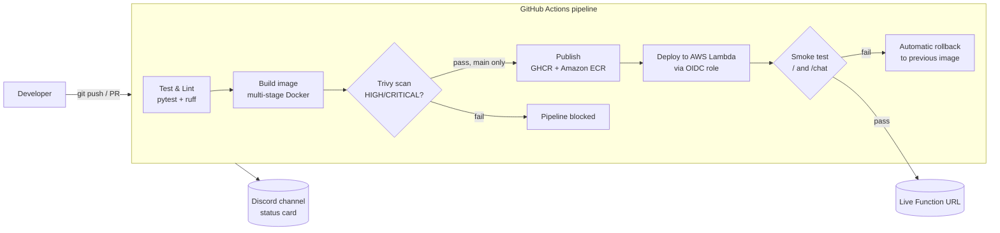

# Automated CI/CD Pipeline for a Containerized Chatbot with Real-Time Deployment Notifications

A containerized **DevOps Chatbot API** (FastAPI) with a fully automated CI/CD pipeline on GitHub Actions: unit tests → lint → Docker build → Trivy HIGH/CRITICAL guardrail → image published to GHCR and Amazon ECR → deployed to **AWS Lambda** with a post-deployment smoke test and automatic rollback → real-time notifications to a Discord channel.

## Architecture



Every commit to `main` and every pull request flows through the pipeline. If tests fail or Trivy finds a fixable **HIGH or CRITICAL** vulnerability, the pipeline stops *before* anything is published. Pull requests are checked but never deployed. Every run ends with a JSON notification that names the failed stage and gives remediation advice.

## Tech Stack

| Layer | Tool |
|---|---|
| API | FastAPI 0.143.0 + Uvicorn 0.54.0 (Python 3.12) |
| Testing | pytest 9.1.1, httpx 0.28.1 |
| Linting | ruff 0.17.0 |
| Containerization | Docker (multi-stage build, non-root user, `python:3.12-slim`) |
| CI/CD | GitHub Actions |
| Security scanning | Trivy (`aquasecurity/trivy-action` v0.36.0, pinned to its commit SHA): HIGH + CRITICAL guardrail |
| Registries | GitHub Container Registry (GHCR), Amazon ECR |
| Hosting | AWS Lambda (container image + AWS Lambda Web Adapter, vendored and checksum-verified), public Function URL |
| Cloud auth | GitHub OIDC → least-privilege IAM role (no stored AWS keys) |
| Notifications | Discord webhook (colour-coded embed card); any other webhook URL receives plain JSON |

## Repository Structure

```
chatbot-cicd-pipeline/
├── .github/workflows/pipeline.yml   # CI/CD pipeline definition
├── Dockerfile                        # multi-stage, non-root container build
├── requirements.txt                  # runtime dependencies
├── requirements-dev.txt              # test + lint dependencies
├── pyproject.toml                    # pytest + ruff configuration
├── app/
│   ├── __init__.py
│   ├── main.py                       # FastAPI application
│   └── test_main.py                  # pytest suite (8 tests)
├── vendor/lambda-adapter/            # AWS Lambda Web Adapter binary + provenance/checksum
├── infra/
│   ├── aws-bootstrap.sh              # one-time AWS setup (ECR, Lambda, OIDC role)
│   └── aws-teardown.sh               # removes all AWS resources
└── docs/screenshots/                 # pipeline evidence (see below)
```

## API

| Endpoint | Method | Description |
|---|---|---|
| `/` | GET | Health check → `{"status": "healthy", "service": "chatbot"}` |
| `/chat` | POST | Body `{"message": "<text>"}`. Known commands: `ping` → `pong`, `status` → operational status, `cost` → budget run rate. Unknown messages get a helpful fallback reply. Invalid payloads return `422`. |
| `/docs` | GET | Interactive Swagger UI (generated by FastAPI) |

```bash
curl -s localhost:8000/
curl -s -X POST localhost:8000/chat -H 'Content-Type: application/json' -d '{"message": "ping"}'
```

## Run Locally

```bash
python3 -m venv .venv
.venv/bin/pip install -r requirements.txt -r requirements-dev.txt

.venv/bin/uvicorn app.main:app --reload     # run the API
.venv/bin/python -m pytest -v               # tests
.venv/bin/ruff check app/                   # lint

docker build -t chatbot-api .               # run in Docker
docker run -p 8000:8000 chatbot-api
```

## CI/CD Pipeline

Triggered on **push to `main`**, **pull requests targeting `main`**, and manual runs:

1. **Run Unit Tests & Lint**: `ruff check app/`, then `pytest` (8 tests covering every endpoint, fallback behavior and 422 validation).
2. **Build, Scan & Publish**: builds the image and scans it with Trivy. Any fixable HIGH or CRITICAL CVE fails the pipeline. On `main` only, the image is pushed to GHCR (`latest` + commit sha) and to Amazon ECR.
3. **Deploy to AWS Lambda** (`main` only, when AWS is configured): records the running image, rolls out the new one, then smoke-tests `/` and `/chat` on the live URL. If the smoke test fails, the previous image is restored automatically. The run appears under the repository's **production** environment with the live URL.
4. **Notify**: posts a status card to Discord for every run, PRs included: green for `DEPLOYED` / `PR_CHECKS_PASSED`, red for `BLOCKED` / `FAILED`, orange for `ROLLED_BACK`, with the failed stage, fix advice and a link to the run. If the secret holds a non-Discord URL, the same summary is sent as plain JSON instead.

The summary behind each card (also what a non-Discord webhook receives):

```json
{"service": "chatbot-api", "status": "DEPLOYED", "source": "main", "commit": "4e8970e",
 "advice": "New version is live and passed the smoke test.",
 "live_url": "https://<id>.lambda-url.ap-south-1.on.aws/", "run_url": "https://github.com/..."}

{"service": "chatbot-api", "status": "BLOCKED", "failed_stage": "Trivy security scan", "source": "PR #4",
 "advice": "Upgrade the vulnerable package in requirements.txt or update the base image in the Dockerfile."}
```

Possible `status` values: `DEPLOYED`, `PUBLISHED` (AWS not configured), `PR_CHECKS_PASSED`, `BLOCKED` (tests, container build or Trivy), `FAILED` (registry push), `ROLLED_BACK`.

### Secrets

| Secret | Purpose |
|---|---|
| `NOTIFICATION_WEBHOOK` | Discord webhook URL (Server Settings → Integrations → Webhooks) |
| `AWS_ROLE_ARN` | IAM role printed by `infra/aws-bootstrap.sh`. If it is missing, the deploy stage is skipped and the pipeline still passes. |
| `GITHUB_TOKEN` | Provided automatically; granted `packages: write` for GHCR |

### AWS setup (one time)

```bash
AWS_PROFILE=<admin-profile> ./infra/aws-bootstrap.sh
```

This creates the ECR repository, the Lambda function with its public URL, and an IAM role that only GitHub Actions runs from this repository's `main` branch (or `production` environment) can assume. GitHub's OIDC token identifies the repository by its immutable owner and repository IDs (`repo:OWNER@OWNER_ID/REPO@REPO_ID:...`), so a deleted-and-recreated repository with the same name cannot assume the role. The role can push to this ECR repository and update this one function, nothing else. `./infra/aws-teardown.sh` removes everything.

The Lambda Web Adapter binary is committed under `vendor/` rather than pulled from `public.ecr.aws` at build time: that registry rate-limits anonymous pulls from shared CI runners, which made builds fail at random. The Dockerfile verifies its SHA-256 on every build.

## Demonstrating the Guardrails

Two branches each contain one deliberate defect. Open a PR from either to see the pipeline block it:

| Branch | Change | Expected result |
|---|---|---|
| `demo/failing-test` | `ping` replies `PONG!` instead of `pong` | Tests fail → `BLOCKED` at *Unit tests / lint* |
| `demo/vulnerable-image` | Base image pinned to the outdated `python:3.10.0-slim` | Tests pass, Trivy finds 100+ HIGH/CRITICAL CVEs → `BLOCKED` at *Trivy security scan* |

Close these PRs without merging.

## Pipeline Evidence

| Screenshot | What it shows |
|---|---|
| `docs/screenshots/actions-run.png` | Green run: tests → build/scan/publish → deploy → notify |
| `docs/screenshots/ghcr-package.png` | Published image in GitHub Packages |
| `docs/screenshots/live-url.png` | The chatbot answering on its AWS Lambda URL |
| `docs/screenshots/webhook-deployed.png` | `DEPLOYED` card in Discord |
| `docs/screenshots/webhook-blocked.png` | `BLOCKED` card in Discord from a demo PR |

<!-- Paste the screenshots above into docs/screenshots/ to complete the report -->
